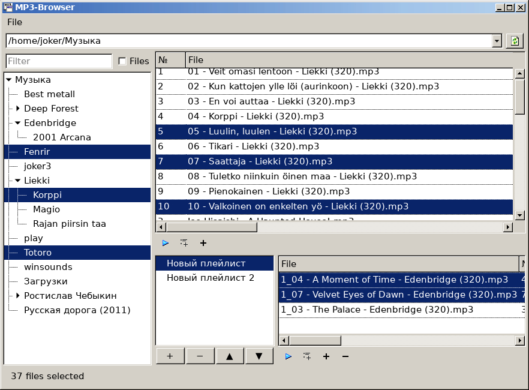

# 🎵 MP3-Browser for Linux

A modern, lightweight reimagining of classic file-tree music browsers (like those from the early 2000s). Written in pure **GJS (GNOME JavaScript)** and **GTK3**, this application is designed for speed, minimalism, and seamless integration with remote music libraries.

Developed primarily in [Russian](https://github.com/nestoris/mp3-browser-rus), with ongoing efforts to support full localization.



---

## ✨ Key Features & Unique Capabilities

This is not just another music player. It's a powerful **music catalog browser** designed with network libraries in mind.

*   **🌐 Native Support for Remote Libraries (Wi-Fi, DAV, SMB)**
    Built to handle libraries with tens of thousands of tracks over slow connections. The interface never freezes: directories are scanned asynchronously, and ID3 tags are loaded dynamically as you scroll or open folders.
*   **📦 Portable Relative-Path Cache**
    Unlike other tools that tie caches to absolute mount paths, MP3-Browser can generate portable JSON caches directly inside your music folder. This means a server (e.g., Android/Termux) can scan the library once, and a client (e.g., a Linux PC connected via GVFS) can open the exact same folder by a different path and instantly see all tags without rescanning.
*   **🚀 Standalone CLI Scanner (`mp3-scanner.js`)**
    Need to scan 60,000 tracks on a headless server? The bundled CLI tool can generate tree structures and extract ID3 tags (v1 and v2) without even launching the GUI. The `apply` command lets you update tags *only* for newly added files, saving hours of scanning.
*   **🎛️ Bring Your Own Player**
    The program acts as a commander. Configure custom shell commands for "Play" and "Enqueue" in the settings. Use `mpv`, `vlc`, `termux-media-player`, or any other CLI-capable player. Supports batch playback via automatically generated `.m3u8` temporary files.
*   **🖱️ Thunar-style Multi-Selection & Drag-and-Drop**
    Smooth, native-feeling multiple file selection with proper drag-and-drop support (including custom drag icons showing exactly how many tracks are being moved). Drop tracks directly into playlists.
*   **📑 Playlists as Bookmarks**
    Simple, file-based playlists stored in JSON. Add, rename, reorder, and remove tracks with ease. Export any playlist to a standard `.m3u8` file for use in other players.
*   **🧠 Smart Sorting**
    Natural numeric sorting for track numbers (1, 2, ..., 9, 10) instead of alphabetical (1, 10, 11, 2). Remember column widths, order, and window geometry between sessions.

---

## 🛠️ System Dependencies

The application requires GJS (or CJS) and GTK3. No heavy Electron or web-engine wrappers required.

### Debian / Ubuntu / Linux Mint
```bash
sudo apt update
sudo apt install gjs libgtk-3-0
```

### Fedora
```bash
sudo dnf install gjs gtk3
```

### Arch Linux / Manjaro
```bash
sudo pacman -S gjs gtk3
```

### openSUSE
```bash
sudo zypper install gjs gtk3
```

### 📱 Android (Termux)
You can run the scanner and (with an X11 environment like VNC or Termux:X11) the GUI directly on Android:
```bash
pkg update
pkg install cjs gtk3
ln -s $PREFIX/bin/cjs $PREFIX/bin/gjs
```
*(Note: For playback via Termux, install `termux-api` and configure the `Play` command in the settings to use `termux-media-player play %f`).*

---

## 🚀 Usage Guide

### 1. First Run & Configuration
Simply run the browser and point it to your music directory:
```bash
./mp3-browser.js /path/to/your/music
```
On the first launch, it will create configuration files in `~/.config/mp3-browser/`:
*   `config.ini`: Define root folders, player commands, and scanning limits.
*   `window.json`: Remembers window size, panel positions, and column layouts.
*   `playlists.json`: Stores your custom playlists.

**Example `config.ini`:**
```ini
[Paths]
Roots=/home/user/Music;/mnt/nas/Music

[Player]
# %f is replaced with the file path or temporary .m3u8 path
Play=mpv --no-video %f
Enqueue=mpv --no-video --append %f
MultipleTracksUseM3U=true

[Scan]
MaxTrackCount=20000
LogEvery=500
```
*(The GUI settings dialog can also be accessed via the `File -> Settings` menu).*

### 2. Portable CLI Caching (The "Killer Feature")

If your music library is on a slow network drive or a server, you can pre-scan it. The scanner creates relative-path caches (`mp3-file-cache.json` and `mp3-tag-cache.json`) right inside the music folder.

**Generate a file tree (fast, no ID3 reading):**
```bash
gjs mp3-scanner.js scan /path/to/Music /path/to/Music/mp3-file-cache.json
```

**Read ID3 tags for the whole tree (can take a while):**
```bash
gjs mp3-scanner.js tags /path/to/Music/mp3-file-cache.json /path/to/Music/mp3-tag-cache.json
```

**Update tags ONLY for newly added files (compares tree with existing cache):**
```bash
gjs mp3-scanner.js apply /path/to/Music/mp3-file-cache.json /path/to/Music/mp3-tag-cache.json
```

**All-in-one (scan + read all tags):**
```bash
gjs mp3-scanner.js cache /path/to/Music
```

When you later open this folder in the GUI (no matter if it's `/home/user/Music` or `/run/user/1000/gvfs/dav:host=.../Music`), the browser will instantly read these JSON files and display your library without any network delays.

### 3. GUI Controls
*   **Left Tree**: Filters directories (check the "Files" box to filter by filenames inside directories).
*   **Top Right Table**: Displays tracks. Double-click or press `Enter` to play. Right-click for context actions (play, enqueue, add to playlist).
*   **Bottom Right Panel**: Manage playlists. Drag and drop tracks from the top table into a playlist. Export playlists to `.m3u8`.
*   **Toolbars**: Use the icons below the tables for quick Play, Enqueue, and Add-to-Playlist actions (supports multiple selection).

---

## ⚙️ Technical Details
*   **Language:** GJS (GNOME JavaScript) / CJS (Cinnamon JavaScript)
*   **UI Toolkit:** GTK3
*   **ID3 Parser:** Custom, highly optimized pure-JS parser (supports ID3v1, ID3v2.2/2.3/2.4, UTF-8, UTF-16, Latin-1).
*   **No external dependencies** for tag parsing (no `ffprobe` or `taglib` required).

## 📄 License
*(GPLv3)*
```

---
